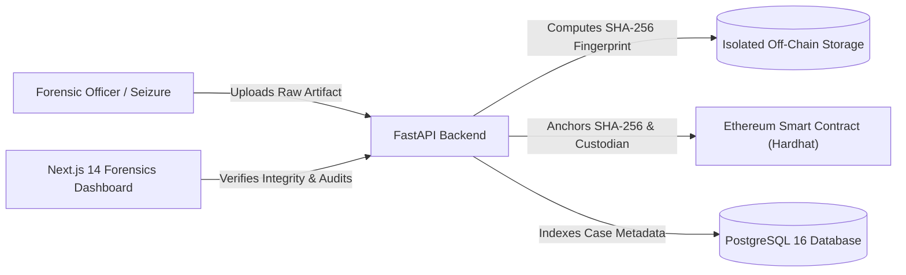

# Blockchain-Based Digital Evidence Chain-of-Custody System

[](https://soliditylang.org/)
[](https://fastapi.tiangolo.com/)
[](https://nextjs.org/)
[](https://www.postgresql.org/)
[](https://www.docker.com/)

An enterprise-grade cyber forensics system that guarantees the **legal admissibility**, **mathematical integrity**, and **non-repudiation** of digital evidence using Ethereum smart contracts and cryptographic proofs.

---

## 1. System Overview & Problem Statement

In conventional law enforcement and corporate forensics, digital evidence (disk images, bodycam footage, logs, mobile extractions) is vulnerable to silent corruption, intentional tampering, and administrative disputes over who held custody. 

This project solves this critical challenge by separating **raw evidence storage** from **cryptographic verification**:
- **Raw Evidence Artifacts** stay off-chain in secure, isolated storage volumes.
- **Cryptographic Fingerprints (SHA-256)** and **Chain-of-Custody Transitions** are permanently anchored to an Ethereum smart contract.
- Any unauthorized modification of the evidence file on disk is immediately detected via live hash comparison against the blockchain.



---

## 2. Key Capabilities & Features

- **Authoritative Smart Contract (`EvidenceChainOfCustody.sol`):**
  - Immutable SHA-256 hash anchoring (no overwrite functions exist).
  - Duplicate evidence ID rejection.
  - Relayer-backed custody transitions enforcing officer address accountability.
  - Chronological event logs (`EvidenceRegistered`, `CustodyTransferred`).
- **Secure Backend API (FastAPI + Web3.py):**
  - Streaming file ingestion with server-side SHA-256 computation (never trusts client hashes).
  - Path traversal protection and UUID-based physical storage names.
  - Role-Based Access Control (RBAC) across 5 forensic clearance tiers.
  - Live cryptographic integrity verification endpoint with tamper detection.
- **Modern Forensics Dashboard (Next.js 14 + Tailwind CSS):**
  - Dark navy/slate sidebar with authoritative forensic lab layout.
  - Live Hardhat node connection monitor and block height indicator.
  - Searchable, filterable evidence catalog.
  - Interactive custody transfer modal with transaction receipt confirmation.
  - Chronological chain-of-custody timeline verified from blockchain event logs.
  - Instant cryptographic mismatch alerts for tampered files.
- **Containerized Orchestration (Docker Compose):**
  - Fully orchestrated 4-tier stack (`blockchain`, `postgres`, `backend`, `frontend`).
  - Health checks, readiness dependencies, and persistent volumes.

---

## 3. Technology Stack

| Layer | Technologies Used | Purpose |
|---|---|---|
| **Blockchain** | Solidity `^0.8.24`, Hardhat, Ethers.js | EVM smart contract, deployment scripts, local ledger |
| **Backend API** | Python 3.11, FastAPI, Web3.py, SQLAlchemy, Alembic | RESTful API, blockchain client, streaming SHA-256 |
| **Database** | PostgreSQL 16 (Alpine) | Structured case metadata, user accounts, audit logging |
| **Frontend** | Next.js 14 (App Router), TypeScript, Tailwind CSS, Lucide | Responsive digital forensics terminal and dashboards |
| **Security** | Argon2 / Bcrypt, OAuth2 JWT (PyJWT), RBAC | Identity management, role clearance enforcement |
| **DevOps** | Docker, Docker Compose, Multi-stage builds | Production and demonstration orchestration |

---

## 4. Project Directory Structure

```text
Blockchain-Evidence-Chain-of-Custod/
├── blockchain/                      # Ethereum Smart Contract Tier
│   ├── contracts/
│   │   └── EvidenceChainOfCustody.sol   # Authoritative smart contract
│   ├── scripts/
│   │   └── deploy.js                # Auto-deployment & ABI exporter
│   ├── test/
│   │   └── EvidenceChainOfCustody.test.js # 21 smart contract test cases
│   ├── hardhat.config.js            # Hardhat EVM network configuration
│   ├── entrypoint.sh                # Container startup & RPC readiness
│   └── Dockerfile
├── backend/                         # Application & API Tier
│   ├── app/
│   │   ├── api/routes/              # auth, users, evidence, dashboard, blockchain
│   │   ├── blockchain/              # Web3.py client & contract integration
│   │   ├── core/                    # Security, settings, and error handlers
│   │   ├── db/                      # SQLAlchemy session & demo seeders
│   │   ├── models/                  # User, Evidence, Transaction, IntegrityCheck
│   │   ├── schemas/                 # Pydantic validation schemas
│   │   ├── services/                # Evidence, Storage, and Audit services
│   │   └── main.py                  # FastAPI lifespan & application entrypoint
│   ├── alembic/                     # Database schema migrations
│   ├── tests/                       # Pytest test suite (auth, custody, integrity)
│   ├── entrypoint.sh                # DB & Blockchain retry readiness
│   ├── requirements.txt             # Python dependencies
│   └── Dockerfile
├── frontend/                        # Presentation Tier (Next.js 14)
│   ├── app/                         # App Router pages (login, dashboard, evidence, etc.)
│   ├── components/                  # Timeline, VerificationCard, TransferModal, Badges
│   ├── context/                     # AuthContext & RBAC clearance
│   ├── lib/                         # Typed API client & format utilities
│   ├── types/                       # TypeScript interfaces
│   ├── package.json
│   ├── tailwind.config.ts
│   └── Dockerfile
├── docs/                            # In-Depth Documentation Deliverables
│   ├── architecture.md              # Architectural specification & Mermaid diagrams
│   ├── api.md                       # Full REST API documentation
│   └── demonstration-guide.md       # University presentation & defense script
├── storage/evidence/                # Persistent isolated evidence storage
├── docker-compose.yml               # Multi-container orchestration
├── .env.example                     # Environment configuration template
└── README.md
```

---

## 5. Quickstart & Running with Docker

### Prerequisites
- Docker Engine `24.0+`
- Docker Compose `v2.20+`

### 1. Clone & Configure
```bash
git clone https://github.com/NumanMohsen-Dev/blockchain.git
cd Blockchain-Evidence-Chain-of-Custod
cp .env.example .env
```

### 2. Build and Start All Containers
```bash
# Build and launch all 4 services in the background
docker compose up --build -d
```

### 3. Verify Container Health
```bash
docker compose ps
```
All containers will display status `Up` / `healthy`:
- `evidence_blockchain` &rarr; `http://localhost:8545`
- `evidence_postgres` &rarr; `localhost:5432`
- `evidence_backend` &rarr; `http://localhost:8000` (Docs: `http://localhost:8000/docs`)
- `evidence_frontend` &rarr; `http://localhost:3000`

### 4. Open the Web Application
Open your browser and navigate to: **`http://localhost:3000`**

---

## 6. Pre-Seeded Demonstration Accounts

For academic review, 5 demonstration accounts are automatically initialized with password: **`EvidencePass123!`**

| Role | Email | Ethereum Address | Allowed Operations |
|---|---|---|---|
| **Administrator** | `admin@evidence.org` | `0xf39Fd6e51aad88F6F4ce6aB8827279cffFb92266` | Full system control, user provisioning |
| **Evidence Collector** | `collector@evidence.org` | `0x70997970C51812dc3A010C7d01b50e0d17dc79C8` | Evidence upload & on-chain registration |
| **Investigator** | `investigator@evidence.org` | `0x3C44CdDdB6a900fa2b585dd299e03d12FA4293BC` | Evidence inspection, custody transfer |
| **Forensic Analyst** | `analyst@evidence.org` | `0x90F79bf6EB2c4f870365E785982E1f101E93b906` | Hash verification, technical analysis |
| **Court Reviewer** | `court@evidence.org` | `0x15d34AAf54267DB7D7c367839AAf71A00a2C6A65` | Read-only judicial audit trail review |

> **Note:** The login screen provides 1-click quick-fill buttons for all demonstration accounts.

---

## 7. Demonstration & Tamper Detection Experiment

For a detailed walkthrough, see [`docs/demonstration-guide.md`](file:///c:/Users/USER/Documents/University/Sem%207/BlockChain/Blockchain-Evidence-Chain-of-Custod/docs/demonstration-guide.md).

### The Tamper Detection Experiment
1. Ingest an evidence file as `collector@evidence.org` at `/evidence/register`.
2. Inspect the evidence dossier: verify the **On-Chain Confirmed** badge and original SHA-256 hash.
3. Click **Verify Integrity Now**: verify that the live hash matches the blockchain hash (`VERIFIED`).
4. Enter the backend container and simulate evidence tampering:
   ```bash
   docker exec -it evidence_backend /bin/sh
   echo "MALICIOUS_TAMPERED_BYTES" >> /app/storage/evidence/<storage_filename>
   exit
   ```
5. Click **Verify Integrity Now** again in the dashboard:
   - **Outcome:** The dashboard immediately flags a **RED ALERT: CRYPTOGRAPHIC HASH MISMATCH**.
   - The on-chain hash remains immutable and untouched, proving the file has been altered since collection.

---

## 8. Common Docker Commands

```bash
# View live logs across all containers
docker compose logs -f

# View backend logs specifically
docker compose logs -f backend

# Stop services (preserves database and evidence storage volumes)
docker compose down

# Restart all services
docker compose restart

# CAUTION: Destructive restart (deletes persistent database and evidence storage)
docker compose down -v
```

---

## 9. Comprehensive Documentation Deliverables

- 📄 [System Architecture & Data Flows](docs/architecture.md)
- 📄 [REST API Specification](docs/api.md)
- 📄 [Academic Demonstration & Defense Guide](docs/demonstration-guide.md)

---

## 10. License & Academic Disclaimer

Developed for academic demonstration and research in Blockchain Technology and Digital Forensics.
Not intended for production law enforcement deployment without integration with a sanctioned hardware security module (HSM) and enterprise key management service (KMS).
