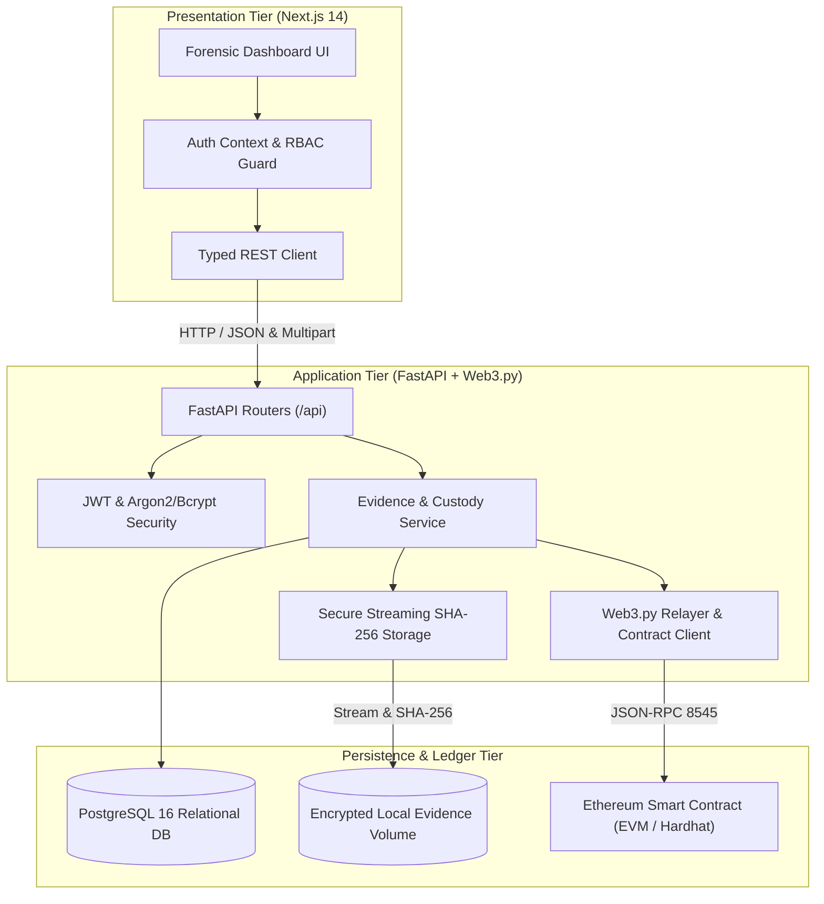
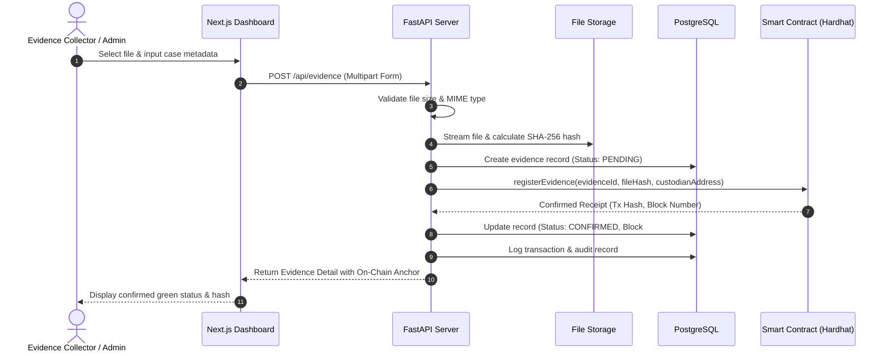
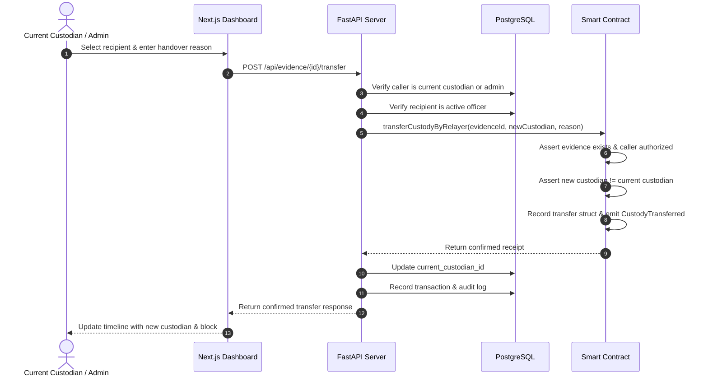
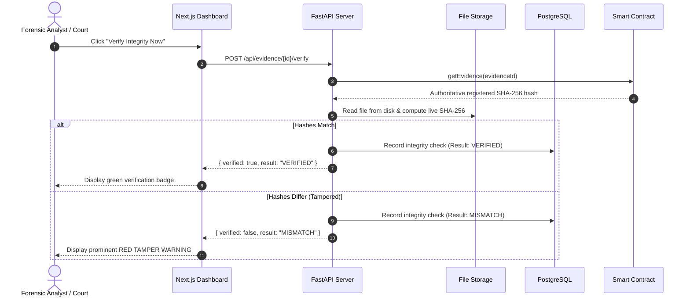
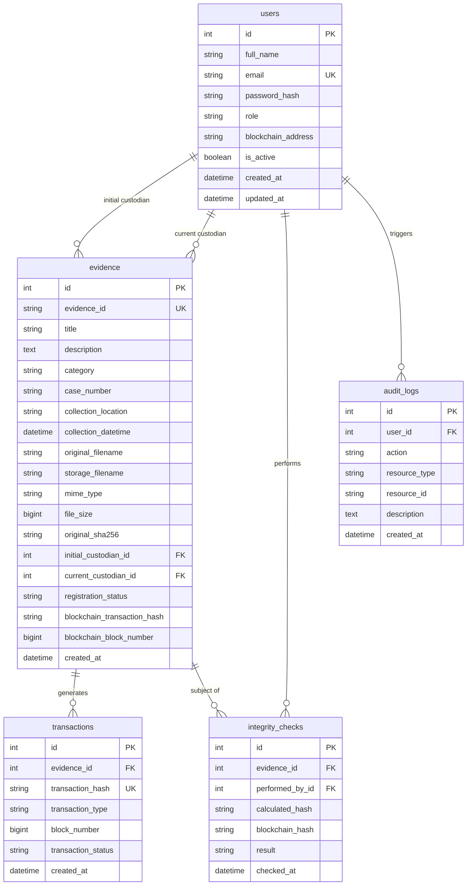

# System Architecture: Blockchain-Based Digital Evidence Chain of Custody

## 1. Executive Architecture Summary

The **Blockchain-Based Digital Evidence Chain-of-Custody System** is an enterprise-grade digital forensics platform designed to guarantee legal admissibility, non-repudiation, and mathematical tamper-evidence for digital artifacts.

It resolves a fundamental challenge in cyber forensics: **how to maintain immutable audit trails of custody without storing massive binary files on the blockchain**.

---

## 2. The Hybrid Storage & Verification Model

### Why Raw Evidence Never Goes On-Chain
- **Scalability & Gas Cost:** Forensics files (disk images, 4K bodycam videos, memory dumps) range from megabytes to gigabytes. Storing such payloads on EVM storage is prohibitive and degrades network nodes.
- **Privacy & Judicial Privilege:** Storing raw evidence on a distributed ledger creates confidentiality liabilities and risks exposure of sensitive witness details.

### The Cryptographic Proof Separation
1. **Raw Artifact Storage (Off-Chain):**
   - The file is uploaded through an authenticated stream.
   - The server computes the authoritative SHA-256 checksum during ingestion.
   - The file is saved to an isolated directory using a cryptographically generated UUID filename (preventing path traversal and filename collision).
2. **Cryptographic Ledger Anchor (On-Chain):**
   - The 256-bit hash, initial custodian Ethereum address, evidence ID, and block timestamp are committed to the `EvidenceChainOfCustody` smart contract.
3. **Database Audit Layer (Off-Chain):**
   - PostgreSQL stores rich metadata (case number, officer notes, collection GPS location, MIME types) to enable instant search and faceted filtering.

---

## 3. Detailed Data Flows

### A. Evidence Registration & Ingestion Sequence

### B. Custody Handover Sequence

### C. Live Cryptographic Integrity Verification

---

## 4. Database Entity-Relationship Model

---

## 5. Smart Contract Design & Authoritative Logic

The smart contract [`blockchain/contracts/EvidenceChainOfCustody.sol`](file:///c:/Users/USER/Documents/University/Sem%207/BlockChain/Blockchain-Evidence-Chain-of-Custod/blockchain/contracts/EvidenceChainOfCustody.sol) acts as the immutable single source of truth.

### Key Guarantees
1. **Hash Immutability:** There is no function in the smart contract that permits updating or overwriting `originalHash`. Once set, it cannot be altered by anyone, including the contract owner.
2. **Duplicate Prevention:** Re-registering an existing `evidenceId` reverts immediately with `EvidenceAlreadyRegistered`.
3. **Authorized Custody Transitions:** Only the current custodian or authorized relayer operator can initiate a custody transfer.
4. **Non-Trivial Custody Handoff:** Self-transfers (`newCustodian == currentCustodian`) are rejected with `SameCustodianTransferNotAllowed`.
5. **Auditable Event Stream:** `EvidenceRegistered` and `CustodyTransferred` events contain block numbers and timestamps that form an unforgeable timeline.

---

## 6. Threat Modeling & Security Controls

| Threat | Attack Vector | System Defense |
|---|---|---|
| **Evidence Tampering** | Attacker modifies file bytes on local disk | Live verification computes real-time SHA-256, flags immediate `MISMATCH`, and preserves on-chain hash. |
| **Unauthorized Transfer** | Non-custodian attempts to reassign evidence | Backend RBAC verifies caller identity against current custodian record; smart contract verifies caller address. |
| **Path Traversal** | Malicious filename such as `../../etc/passwd` | Filenames on disk are generated as random UUIDs; original filenames are stored solely as descriptive metadata. |
| **Privilege Escalation** | Regular officer creates admin account | User creation and role reassignment endpoints are restricted strictly to the `ADMIN` role. |
| **Denial of Service** | Oversized file upload exhausting disk | Streaming upload validates content size against `MAX_UPLOAD_SIZE_BYTES` (100 MB default) and aborts if exceeded. |

